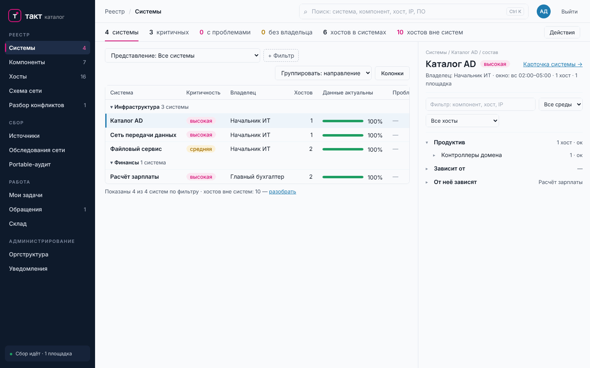
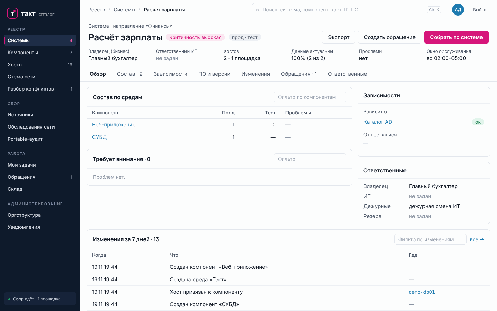
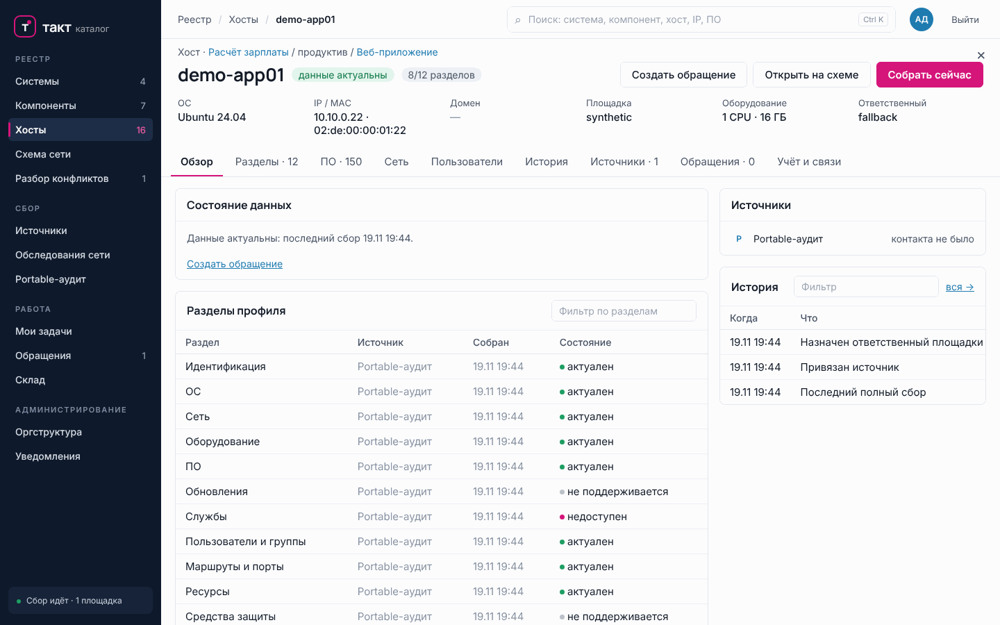
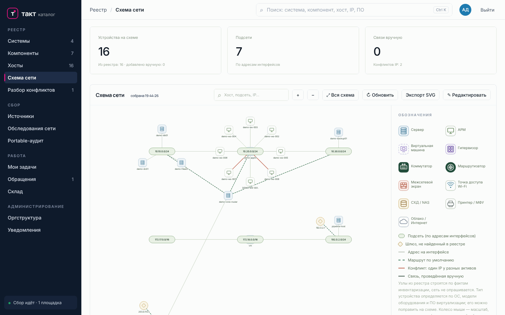

<p align="center">
  
</p>

<h1 align="center">ТАКТ.Каталог</h1>

<p align="center">
  <b>Постоянная инвентаризация и реестр ИТ-инфраструктуры: системы, хосты, ПО и сеть в одном месте и всегда актуальные.</b>
</p>

<p align="center">
  <a href="v2/deploy/USER-GUIDE.md">Руководство пользователя</a> ·
  <a href="v2/deploy/OPERATIONS.md">Установка и эксплуатация</a> ·
  <a href="docs/STATUS.md">Текущее состояние</a>
</p>



> **Пилот.** Основное работает и проверено в CI, сейчас идёт длительный прогон на стенде. Возможны шероховатости.
> В коде и командах продукт пока называется **SurveyScan**, переименование в ТАКТ запланировано.

## Что умеет

### Системы, а не просто список компьютеров

Реестр устроен так же, как вы думаете об ИТ: **направление → система → среда (прод, тест…) → компонент → хосты**.
По каждой системе видно, сколько у неё хостов, насколько свежие данные, что сломано и от чего она зависит.
Цвет состояния считается автоматически: давно не было инвентаризации, хост пропал из сети, отклонение от эталона
или конфликт данных.



- **Карточка системы**: состав по средам, «требует внимания», зависимости, ПО и версии, изменения за 7 дней,
  обращения, ответственные (владелец, ИТ, дежурные, резерв).
- **Карточка компонента**: хосты с IP и площадкой, эталон (какая ОС и версии должны быть) и отклонения от него.
- **Правила привязки**: новые хосты попадают в нужный компонент сами (по маске имени, подсети, классу актива или установленному ПО) или предлагаются
  оператору на подтверждение. Есть массовая привязка и импорт из CSV.
- Хосты, не попавшие ни в одну систему, собраны в отдельной очереди «Вне систем».

### Всё о хосте на одной странице



12 разделов профиля: идентификация, ОС, сеть, оборудование, ПО, обновления, службы, пользователи и группы,
маршруты и порты, ресурсы, средства защиты, сетевые соседи. По каждому разделу видно, кто и когда его собрал.
Если данные устарели, карточка объясняет почему: агент не выходит на связь, сбор по WinRM падает с ошибкой или
обследование сети видит хост, но данных от него нет. Сбор можно запросить кнопкой. Из карточки можно создать
обращение и открыть хост на схеме сети. История имён, слияний и передач тоже хранится в карточке.

### Схема сети строится сама



Схема L3 строится по адресам интерфейсов и маршрутам из инвентаризации, сеть при этом не опрашивается.
Тип устройства (сервер, АРМ, маршрутизатор, принтер…) определяется по ОС, модели и ПО виртуализации.
Конфликты IP подсвечиваются. Схему можно поправить вручную и выгрузить в SVG.

### Сбор данных: агент, без агента или разово

- **Агент** на Linux (служба systemd) и Windows (служба SCM). Агент копит данные на диске и досылает их после обрыва связи.
- **Collector площадки** собирает данные без агента: по **SSH**, **WinRM** и **SNMPv3**. Пароли и ключи хранятся в хранилище секретов.
- **Обследование сети**: поиск узлов в заведённых подсетях (TCP-порты, ARP, ping). Показывает, что нового и что пропало.
- **Portable-аудит** — разовый сбор без установки службы: файл переносится вручную или загружается по HTTPS.
- **Установка по коду**: администратор создаёт одноразовый код в Web, а агент или collector регистрируется по нему
  с проверкой отпечатка центра.

### Учёт и работа с реестром

- **Ответственность**: люди и команды, передача активов, резервная команда площадки, синхронизация с AD.
- **Разбор конфликтов**: слияние и разделение карточек, если источники описывают один хост по-разному.
- **Поиск** по всему реестру (`Ctrl K`) и поиск ПО: на каких машинах установлена программа.
- **Склад и выдача**: приход, выдача, возврат, ремонт, списание, инвентаризация, акты.
- **Обращения**: инциденты, заявки по каталогу услуг, SLA, календарь изменений, портал сотрудника.
- **Обмен**: CSV/Excel и 1С, уведомления внешним системам (ITSM, мониторинг) подписанным HTTP-запросом.
- Работа через **Web**, CLI `surveyscanctl` и **HTTP API** с JSON Schema-контрактами.

### Безопасность

- Сбор **только на чтение**: ТАКТ ничего не меняет на хостах.
- Каждое наблюдение **подписано** (Ed25519) и передаётся по **mTLS**. Центр принимает данные только от зарегистрированных источников.
- Пароли, ключи и токены хранятся в **OpenBao** и не попадают в конфиги, журналы и отчёты. Коды установки хранятся
  только в виде хеша.
- Все изменения в реестре записываются в **аудит**: кто, когда и что сделал.
- Web работает в **закрытом контуре**: шрифты и библиотеки встроены, CDN и внешние запросы не используются.

## Состав

| Программа | Где работает | Для чего |
|---|---|---|
| `surveyscan-server` | Центр, Linux amd64 | API, Web, приём данных, реестр; консоль: миграции, первый администратор, portable-импорт |
| `surveyscan-collector` | Сервер площадки, Linux | Безагентный сбор (SSH, WinRM, SNMPv3), обследование сети, ретрансляция данных агентов |
| `surveyscan-agent` | Серверы и ПК, Linux / Windows | Постоянный сбор на самом хосте |
| `surveyscan-portable` | Любой ПК | Разовый аудит без установки службы |
| `surveyscanctl` | Рабочее место администратора | CLI: активы, источники, состояние |
| Web UI | Браузер | Отдельная статическая сборка, раздаётся nginx |

Внешние компоненты центра: **PostgreSQL 17**, **OpenBao 2.7**, nginx (TLS), systemd ≥ 252.

## Установка

Коротко:

1. Подготовить PostgreSQL, OpenBao и TLS-сертификаты.
2. Проверить подпись выпуска и установить его (`release.py verify`, `release.py stage`).
3. Применить миграции (служба `surveyscan-migrate`) и создать первого администратора:
   `surveyscan-server bootstrap-admin --tenant … --password-file …`.
4. В Web («Источники» → «Установка») создать код и поставить collector площадки, затем агенты:
   `surveyscan-collector register --center https://<центр> --fingerprint <отпечаток> …`.
5. Проверить установку: `healthcheck`, вход в Web, `GET /api/v1/diagnostics` должен отвечать без предупреждений.

Подробно — в [руководстве по эксплуатации](v2/deploy/OPERATIONS.md): обновление с откатом, резервное копирование,
несколько экземпляров, подготовка Windows к WinRM через GPO, вход по SSH с 2FA.
Документы о выпуске — [RELEASE.md](v2/deploy/RELEASE.md) (подпись, SBOM), обновление — [UPDATE.md](v2/deploy/UPDATE.md).

## Журнал и диагностика

- **Центр**: `journalctl -u surveyscan-migrate -u surveyscan-server`. Если центр не стартует, причина указана в журнале:
  расхождение схемы, запечатанный OpenBao, неверные права на приватный конфиг (должны быть 0600).
- **Агент и collector**: `journalctl -u surveyscan-agent`, `journalctl -u surveyscan-collector`. На Windows — «Журнал
  событий», служба SurveyScan Agent.
- **Источник перестал присылать данные**: в Web «Источники» есть «последний контакт» (связь) и «успешный сбор» (данные).
  Связь есть, а сбора нет — сбор падает на хосте. Связи нет — проблема в сети или сертификате.
- **Диагностика центра**: `GET /api/v1/diagnostics` и `healthcheck`.

Пароли, токены и ключи в журналы не пишутся.

## Для разработчиков

```sh
cd v2
make build                                   # все программы → .dist/
go test ./...                                # unit-тесты
(cd web && npm ci && npm run generate && npm run build)
python3 scripts/dev.py up                    # dev-стенд: PostgreSQL + OpenBao в Docker
.contract-tools/bin/python scripts/demo_stand.py   # центр + Web + демо-данные, скриншоты в v2/.local/demo
```

- Стек: Go, PostgreSQL 17, OpenBao, React 19 + TypeScript.
- [Сборка и dev-стенд](v2/README.md) · [спецификация](docs/specifications/go-asset-management-v2.md) ·
  [план работ](docs/plans/surveyscan-v2/README.md) · [оглавление документации](docs/README.md).
- Ветки: `main` — проверенное состояние, `develop` — рабочая.
- `AGENTS.md` и `CLAUDE.md` — инструкции для ИИ-ассистентов, которые ведут разработку.
- Прежняя версия v1 (Python-сканер на nmap) выведена из линии и осталась в истории git (коммит `bd26e78`).
